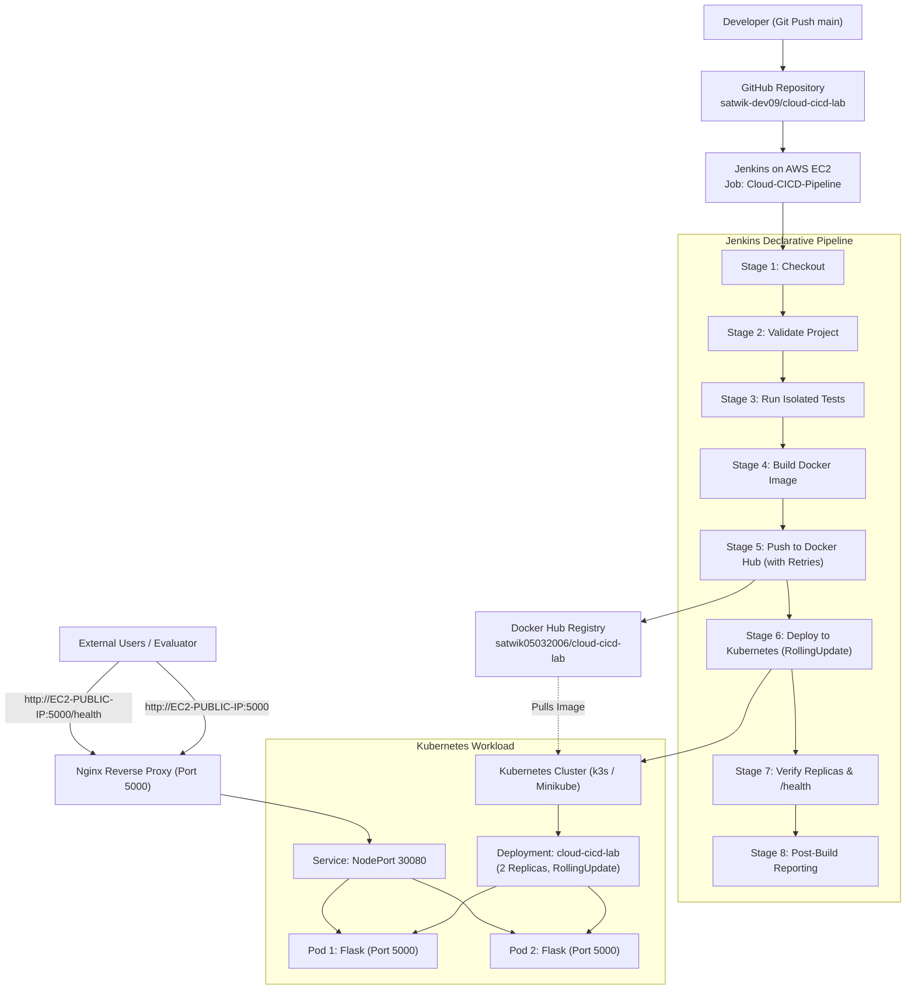

# Cloud CI/CD Demo App: AWS EC2, Jenkins, Docker Hub & Kubernetes Pipeline

An automated, declarative CI/CD pipeline built for the **Cloud Computing and DevOps CCA-2** project. It integrates **GitHub**, **Jenkins on AWS EC2**, **Docker**, **Docker Hub**, and **Kubernetes** to deploy a resilient Python Flask web application accessible over a stable public URL.

---

## 1. System Architecture



---

## 2. Project Structure

```text
cloud-cicd-lab/
├── app.py                  # Flask application with / and /health routes
├── requirements.txt        # Python production dependencies (Flask)
├── Dockerfile              # Container image specification (Python 3.11-slim)
├── .dockerignore           # Excludes git, tests, venvs from Docker build context
├── Jenkinsfile             # 8-stage declarative CI/CD pipeline with retry & verification
├── setup-ec2.sh            # Automated EC2 setup script (Docker, Java, Jenkins, K8s, Nginx)
├── README.md               # Project documentation & viva guide
├── templates/
│   └── index.html          # Web UI showing version and pipeline details
├── tests/
│   └── test_app.py         # Unit tests validating routes and health endpoint
└── k8s/
    ├── deployment.yaml     # 2-replica Deployment with rolling update & health probes
    └── service.yaml        # NodePort Service pinned to port 30080
```

---

## 3. AWS EC2 Sizing & Cost Analysis

| Component | Specification | Reason | Cost (Est.) |
| :--- | :--- | :--- | :--- |
| **Instance Type** | `t3.medium` (2 vCPU, 4 GiB RAM) | Java 21, Jenkins, Docker, and Kubernetes require ~3.2 GiB. `t2.micro` (1 GiB) will crash due to Out-Of-Memory (OOM) during builds. | ~$0.0416/hr (~$1 for 24 hrs) |
| **Operating System** | Ubuntu 24.04 LTS (x86_64) | Stable, widely supported, standard package repositories. | Free Tier eligible OS |
| **Storage (EBS)** | 30 GB gp3 SSD | Docker cache, Kubernetes images, Jenkins build history. | **100% Free Tier** (30 GB/month included) |
| **Public IPv4** | 1 Standard AWS Public IP | Accessible to professors and evaluators. | ~$0.005/hr |

> **Cost Tip**: Always **Stop** the EC2 instance when not testing or demonstrating to eliminate compute charges.

---

## 4. EC2 Security Group Rules

Create a Security Group with the following inbound rules:

| Type | Port Range | Protocol | Source | Purpose |
| :--- | :--- | :--- | :--- | :--- |
| **SSH** | `22` | TCP | `My IP` | Secure terminal access via key pair |
| **Custom TCP** | `8080` | TCP | `My IP` | Jenkins Dashboard (restricted for security) |
| **Custom TCP** | `5000` | TCP | `0.0.0.0/0` | Stable Public Application URL |
| **Custom TCP** | `30080` | TCP | `0.0.0.0/0` | Kubernetes NodePort direct fallback |

---

## 5. One-Click Setup on AWS EC2

1. Launch your EC2 instance (`t3.medium`, Ubuntu 24.04, 30GB disk).
2. Connect to the instance via SSH:
   ```bash
   ssh -i your-key.pem ubuntu@<EC2-PUBLIC-IP>
   ```
3. Run the automated setup script directly:
   ```bash
   curl -fsSL https://raw.githubusercontent.com/satwik-dev09/cloud-cicd-lab/main/setup-ec2.sh | bash
   ```
4. Copy the Jenkins Initial Admin Password displayed at the end of the script:
   ```bash
   sudo cat /var/lib/jenkins/secrets/initialAdminPassword
   ```

---

## 6. Jenkins Pipeline Configuration

1. Open `http://<EC2-PUBLIC-IP>:8080` in your browser.
2. Paste the administrator password and click **Install suggested plugins**.
3. Create your Jenkins Admin user.
4. Add Docker Hub Credentials:
   - Navigate to **Manage Jenkins** → **Credentials** → **System** → **Global credentials (unrestricted)** → **Add Credentials**.
   - **Kind**: `Username with password`
   - **Username**: `satwik05032006`
   - **Password**: *Your Docker Hub Personal Access Token (PAT)*
   - **ID**: `dockerhub-creds`
5. Create the Pipeline Job:
   - Click **New Item** → Name: `Cloud-CICD-Pipeline` → Select **Pipeline** → Click **OK**.
   - Under **Pipeline**, set **Definition** to **Pipeline script from SCM**.
   - **SCM**: `Git`
   - **Repository URL**: `https://github.com/satwik-dev09/cloud-cicd-lab.git`
   - **Branch Specifier**: `*/main`
   - **Script Path**: `Jenkinsfile`
   - Click **Save**.

---

## 7. The 8 Pipeline Stages

1. **Checkout**: Clones `main` branch from GitHub and extracts short commit SHA (`GIT_COMMIT_SHORT`).
2. **Validate Project**: Verifies presence of `app.py`, `Dockerfile`, `requirements.txt`, and manifests.
3. **Install Dependencies & Run Tests**: Creates `.venv`, installs requirements and pytest, executes unit tests.
4. **Build Docker Image**: Builds image tagged with `${BUILD_NUMBER}-${GIT_COMMIT_SHORT}` and `latest`.
5. **Authenticate & Push to Docker Hub**: Uses `dockerhub-creds` with a 3-attempt retry loop to avoid upload timeouts.
6. **Deploy to Kubernetes**: Replaces `IMAGE_PLACEHOLDER` with the new tag, applies manifests, waits for rollout status (`--timeout=180s`).
7. **Verify Deployment**: Validates available replicas $\ge 1$, waits for pods `Ready`, checks image tag matches, verifies `/health`.
8. **Post-Build Reporting**: Prints commit ID, build number, image tag, and the live public URL.

---

## 8. End-to-End Demonstration Steps

To demonstrate the full automation to your professor:

1. **Edit Application**:
   In `app.py`, change:
   ```python
   APP_VERSION = os.environ.get("APP_VERSION", "v2 - Live Demo Update")
   ```
2. **Push to GitHub**:
   ```bash
   git add app.py
   git commit -m "Update application to v2 for live demo"
   git push origin main
   ```
3. **Trigger Pipeline**:
   - Open Jenkins on EC2 (`http://<EC2-PUBLIC-IP>:8080`).
   - Click **Build Now**.
4. **Verify Live Update**:
   - View the console output of Build.
   - Once marked SUCCESS, open `http://<EC2-PUBLIC-IP>:5000` in your browser.
   - The version updates immediately without dropping connection!

---

## 9. Viva & Oral Exam Cheat Sheet

- **Why Jenkins Declarative Pipeline over Freestyle?**
  Declarative pipelines use version-controlled code (`Jenkinsfile`) stored in Git (Pipeline as Code), enabling auditability, repeatability, and branching.
- **Why Docker?**
  Guarantees environment consistency across development, testing, and production ("runs on my machine" problem solved).
- **Why Kubernetes Deployments instead of bare Pods?**
  Deployments provide declarative state management, auto-healing, scaling, and zero-downtime rolling updates.
- **What is the purpose of Readiness and Liveness Probes?**
  - **Readiness probe** (`/health`): Checks when the container is ready to receive network traffic.
  - **Liveness probe** (`/health`): Detects if the app is deadlocked and restarts the container if needed.
- **How is the public URL kept stable?**
  A persistent Nginx reverse proxy forwards host port `5000` to the Kubernetes `NodePort 30080`. Even when pods are replaced during rolling updates, the public IP and port remain unchanged.
